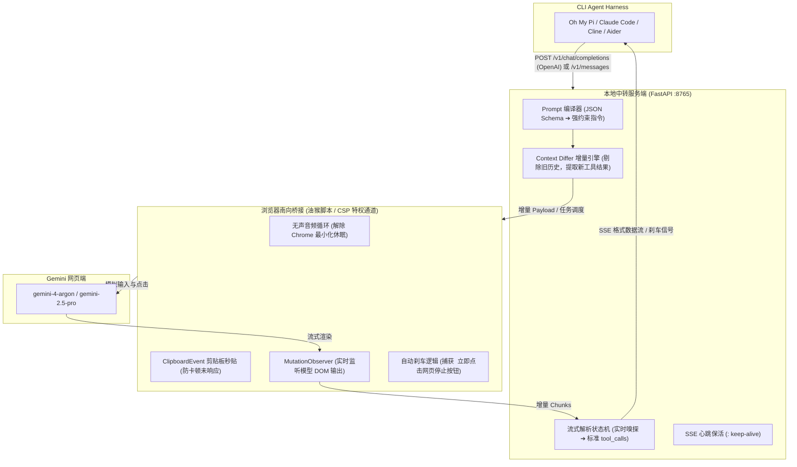
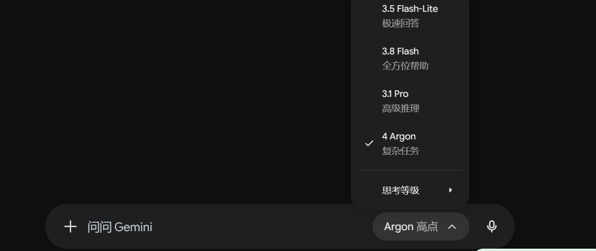

# Gemini Web2API: 网页逆向转接口中转系统

[English Documentation](README_EN.md) | **中文文档**

> **面向 CLI Agent Harness（Oh My Pi, Claude Code, Cline, Codex CLI, Aider 等）的 Gemini Web & Google AI Studio 逆向协议桥接系统，让本地代码代理直接驱动网页端模型（如 `gemini-4-argon`）并原生支持 Tool Calling（工具调用）与增量上下文对齐。**

---

## 目录

- [为什么需要本工具？（核心痛点）](#-为什么需要本工具核心痛点)
- [系统架构与工作原理](#-系统架构与工作原理)
- [核心技术亮点](#-核心技术亮点)
- [一键快速安装](#-一键快速安装)
- [详细使用步骤](#-详细使用步骤)
  - [步骤 1：启动中转服务](#步骤-1启动中转服务)
  - [步骤 2：安装油猴脚本并确认连接](#步骤-2安装油猴脚本并确认连接)
  - [步骤 3：在网页端选定模型与思考等级](#步骤-3在网页端选定模型与思考等级)
  - [步骤 4：连接你的 CLI Agent（以 Oh My Pi 为例）](#步骤-4连接你的-cli-agent以-oh-my-pi-为例)
- [支持的 CLI Agent Harness](#-支持的-cli-agent-harness)
- [思考等级控制（Thinking Level）](#-思考等级控制thinking-level)
- [自动化测试验证](#-自动化测试验证)
- [路线图与开发规划（TODO: ChromeDriver / CDP 驱动模式）](#-路线图与开发规划todo-chromedriver--cdp-驱动模式)
- [开源协议](#-开源协议)

---

## 💡 为什么需要本工具？（核心痛点）

在开源社区中，普通的“网页转 API”工具只能做单向的**纯文本传声筒**。但要让真正具备自动化执行能力的 CLI Agent（如 [Oh My Pi](https://github.com/can1357/oh-my-pi)、Claude Code、Cline、Aider 等）驱动网页端模型，面临两个根本性技术断层：

1. **缺乏原生 `tools` 协议支持：**
   CLI Agent 严重依赖 OpenAI 或 Anthropic 格式的结构化 Function Calling（如调用 `bash` 执行命令、`read_file` 读取源码、`edit_file` 编辑项目）。而网页端对话框只接受纯文本，不会返回结构化的 `tool_calls` 报文。
2. **无状态（Stateless）与有状态（Stateful）的致命冲突：**
   CLI Agent 每次向 API 发起请求，都会携带包含上千行 System Prompt、工具定义和历史回合的完整上下文；而网页端本身在云端维护了会话历史。如果每次都把全量 `messages` 塞进网页输入框，不仅会**撑爆网页输入框字数限制并引发浏览器假死卡顿**，还会造成严重的上下文重复与幻觉污染。

**Gemini Web2API 正是为此而生**：它在本地架设了完整的协议编译层、流式拦截状态机与上下文增量对齐引擎，让网页端模型表现得就像一个原生的标准 OpenAI / Anthropic API。

---

## 🏛️ 系统架构与工作原理



---

## ✨ 核心技术亮点

1. **CSP-Immune 特权通信通道：**
   网页端（`gemini.google.com`）拥有极其严苛的 `Content Security Policy`，会直接封杀普通脚本创建的 `ws://` 或跨域连接。本系统利用 Tampermonkey 的扩展后台特权接口 `GM_xmlhttpRequest`，完全绕过网页 CSP 限制。
2. **剪贴板原生秒贴机制（`ClipboardEvent("paste")`）：**
   针对现代复杂富文本编辑器（Quill / Lit），杜绝低效卡顿的逐字模拟输入，使用原生剪贴板批处理机制，上万字符的复杂 Prompt 在 **10 毫秒以内** 瞬间贴入，彻底解决“网页长时间未响应”的浏览器假死弹窗。
3. **静音音频防休眠（Silent Audio Keep-Alive）：**
   页面内置 0.00001 极微音量的 Web Audio 上下文循环。根据浏览器标准，播放音频的标签页受到免休眠豁免，**即使将浏览器最小化到任务栏或窗口置底，也不会被 Chrome 降频节流或挂起**。
4. **工具调用实时拦截与主动刹车（Auto-Braking）：**
   流式状态机在检测到模型输出闭合标签 `</tool_call>` 的瞬间，不仅解析出工具调用，还会立即向网页端发出指令触发页面上的“停止生成（Stop Generating）”按钮，**从物理层面阻止模型脑补伪造工具执行结果**。
5. **智能会话生命周期管理：**
   * **会话内（Turn-by-turn）：** 增量同步，第二轮只把几十字节的工具输出送入网页。
   * **跨会话（New Session）：** 检测到任务切换时，自动点击网页端“新对话（New chat）”按钮，清空历史，杜绝上下文交叉污染。

---

## 📦 一键快速安装

克隆仓库并运行一键安装脚本（自动检查 Python 环境、安装依赖并生成环境变量模版）：

```bash
git clone https://github.com/Bowen-0x00/gemini-web2api.git
cd gemini-web2api

# 运行一键配置安装脚本
./install.sh
```

---

## 📖 详细使用步骤

### 步骤 1：启动中转服务

在当前项目目录下启动中转后端：

```bash
python3 run_server.py --port 8765
```

服务就绪后会监听：
* **OpenAI API 基础端点：** `http://127.0.0.1:8765/v1`
* **Anthropic API 基础端点：** `http://127.0.0.1:8765`
* **状态面板：** `http://127.0.0.1:8765/`

---

### 步骤 2：安装油猴脚本并确认连接

1. 在你的主力浏览器中安装 [Tampermonkey（油猴）](https://www.tampermonkey.net/) 插件。
2. 打开 Tampermonkey -> “添加新脚本”。
3. 将本项目中的 `userscript/gemini_bridge.user.js` **全选复制粘贴进去并保存**。
4. 打开 [Gemini Web (https://gemini.google.com/app)](https://gemini.google.com/app) 或 [Google AI Studio](https://aistudio.google.com/)。
5. 首次刷新时，若油猴弹出权限询问窗口（*“用户脚本想要连接到 127.0.0.1...”*），点击 **“总是允许此域名”**。
6. 观察网页右下角浮动状态徽标：
   * 🟢 **`Bridge: Connected (Idle)`**：表示已成功连通！

> **💡 如果你的中转服务运行在远程 Linux 服务器上：**
> * **VS Code 用户：** 在界面底部的 **Ports（端口）** 标签页中点击 `Add Port`，添加 `8765`，本地输入 `38765`（或默认配置的端口），VS Code 会全自动处理映射。
> * **原生 SSH 用户：** 在本地终端使用本地端口转发：
>   ```cmd
>   # 在本地执行，将本地 38765 转发到远程服务器的 8765
>   ssh -N -L 38765:127.0.0.1:8765 user@remote_server
>   ```

---

### 步骤 3：在网页端选定模型与思考等级

在网页端选择你想要使用的模型（例如 **`gemini-4-argon`** 或 `gemini-2.5-pro`），脚本会自动嗅探当前页面所选模型并上报。

<p align="center">
  
</p>

---

### 步骤 4：连接你的 CLI Agent（以 Oh My Pi 为例）

在中转服务运行且浏览器显示 🟢 状态下，新开终端加载环境变量并运行：

#### 方案 A：使用内置环境脚本一键加载
```bash
source env_setup.sh

# 运行 Oh My Pi
omp --model lm-studio/gemini-4-argon "请使用 bash 查看当前目录文件并阅读 README.md"
```

#### 方案 B：直接命令行指定
```bash
LM_STUDIO_BASE_URL="http://127.0.0.1:8765/v1" omp -p --approval-mode=yolo --model lm-studio/gemini-4-argon "请使用 bash 执行 pwd 和 whoami"
```

你可以在终端看到 `omp` 成功调度工具并在本地执行命令，同时可在浏览器窗口亲眼目睹整个交互过程！

---

## 🤖 支持的 CLI Agent Harness

得益于标准 OpenAI 与 Anthropic 协议双向兼容，本工具支持任何标准 CLI Agent：

| CLI Agent / Harness | 配置方式 | 推荐使用协议 |
| :--- | :--- | :--- |
| **[Oh My Pi (OMP)](https://github.com/can1357/oh-my-pi)** | `export LM_STUDIO_BASE_URL="http://127.0.0.1:8765/v1"` | OpenAI / LM Studio 协议 |
| **Claude Code** | `export ANTHROPIC_BASE_URL="http://127.0.0.1:8765"` | Anthropic Messages 协议 |
| **Cline (VS Code)** | 设置 Provider 为 `OpenAI Compatible`，Base URL `http://127.0.0.1:8765/v1` | OpenAI 兼容模式 |
| **Aider** | `aider --openai-api-base http://127.0.0.1:8765/v1 --model gemini-4-argon` | OpenAI 协议 |
| **Codex CLI** | `export OPENAI_BASE_URL="http://127.0.0.1:8765/v1"` | OpenAI 协议 |

---

## 🧠 思考等级控制（Thinking Level）

针对 Gemini 4 Argon 等支持深度推理的模型，中转端原生支持在模型名称后追加思考等级后缀：

```bash
# 开启高推理思考等级（深度反思）
omp --model lm-studio/gemini-4-argon:high "设计一套分布式缓存一致性方案"

# 适中思考等级
omp --model lm-studio/gemini-4-argon:medium "快速修复这段代码的语法错误"

# 低思考等级
omp --model lm-studio/gemini-4-argon:low "写一个正则匹配邮箱"

# 关闭思考模式（极速输出）
omp --model lm-studio/gemini-4-argon:off "把这段文字翻译为英文"
```

油猴脚本接收到调用后，会自动在网页端下拉菜单中展开并选中对应的“思考等级”项。

---

## 🧪 自动化测试验证

本项目自带完备的 Mock Browser 自动化测试套件，无需启动真实浏览器即可在 CI / 本地验证全流程：

```bash
python3 -m unittest tests/test_e2e.py
```

测试覆盖链路：
* `GET /v1/models` 模型发现与能力声明
* 基础流式 SSE 对话响应
* 多轮工具调用（Tool Calling 拦截、参数提取、刹车信号触发）
* 增量上下文对齐（Context Differ 验证：第二轮只发工具结果，绝不重复发送全量历史）
* Anthropic `/v1/messages` 兼容通道验证

---

## 🗺️ 路线图与开发规划（TODO: ChromeDriver / CDP 驱动模式）

当前油猴脚本方案具有极佳的免登录与零风控优势。为了实现更彻底的“无人值守、静默后台运行”，后续版本将引入 **Chrome DevTools Protocol (CDP)** 原生驱动后端作为另一种可选运行模式：

- [x] **CDP / ChromeDriver 原生驱动后端（已实现）：**
  - 支持通过 `chrome.exe --remote-debugging-port=9222` 连接已登录的 Chrome 实例，或通过 `--user-data-dir` 独立持久化运行。
  - 通过 CDP 与 DOM 协议直接操作页面输入与网络流式回调，无需油猴插件。
  - **完全脱离窗口约束：** 原生支持窗口彻底最小化（Minimized）、被其他窗口遮挡（Occluded）或后台运行，通过内置静音音频 Keep-Alive 与针对性 Chromium 参数免除后台休眠与定时器节流。
  - 运行指令：`python run_server.py --driver` 或 `python run_chromedriver.py`。
- [ ] **多 Tab 并发请求路由池：** 支持在浏览器中自动开启多个标签页，实现并发请求的自动负载均衡。
- [ ] **CLI Agent 专用扩展插件：** 作为 Oh My Pi 的独立 extension 发布，支持在终端输入 `/gemini-bridge` 一键启动与诊断。

---

## 📄 开源协议

本项目采用 [MIT License](LICENSE) 授权开源。
