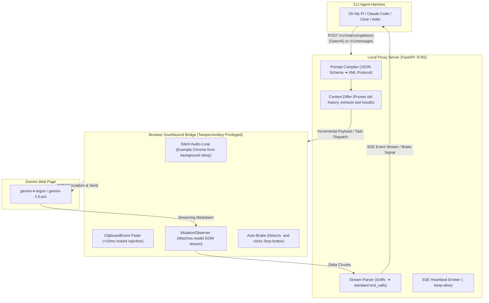

# Gemini Web2API: Reverse Web-to-API Bridge for CLI Agents

**English Documentation** | [中文文档](README.md)

> **A reverse protocol bridge connecting CLI Agent Harnesses (Oh My Pi, Claude Code, Cline, Codex CLI, Aider, etc.) to Gemini Web & Google AI Studio. Seamlessly run web-based flagship models (such as `gemini-4-argon`) with full native Tool Calling and incremental context synchronization.**

---

## Table of Contents

- [Why is This Needed? (Core Pain Points)](#-why-is-this-needed-core-pain-points)
- [System Architecture & Workflow](#-system-architecture--workflow)
- [Key Technical Features](#-key-technical-features)
- [Quick One-Click Installation](#-quick-one-click-installation)
- [Step-by-Step Usage Guide](#-step-by-step-usage-guide)
  - [Step 1: Start the Local Proxy Server](#step-1-start-the-local-proxy-server)
  - [Step 2: Install the Userscript & Verify Bridge Connection](#step-2-install-the-userscript--verify-bridge-connection)
  - [Step 3: Select Model and Thinking Level on Web](#step-3-select-model-and-thinking-level-on-web)
  - [Step 4: Connect Your CLI Agent (e.g. Oh My Pi)](#step-4-connect-your-cli-agent-eg-oh-my-pi)
- [Supported CLI Agent Harnesses](#-supported-cli-agent-harnesses)
- [Thinking Level Control](#-thinking-level-control)
- [Automated Verification Suite](#-automated-verification-suite)
- [Roadmap & Future Work (TODO: ChromeDriver / CDP Mode)](#-roadmap--future-work-todo-chromedriver--cdp-mode)
- [License](#-license)

---

## 💡 Why is This Needed? (Core Pain Points)

Traditional "Web-to-API" reverse proxies only perform simple **text string forwarding**. However, running autonomous coding agents (like [Oh My Pi](https://github.com/can1357/oh-my-pi), Claude Code, Cline, or Aider) against web-based interfaces encounters two critical architectural fractures:

1. **Lack of Native `tools` Protocol Support:**
   CLI Agents depend on OpenAI or Anthropic-formatted structured Function Calling (invoking `bash` commands, `read_file`, `edit_file`). Web dialogs only accept raw text and cannot natively return structured `tool_calls` payloads.
2. **Stateless vs. Stateful Conflict:**
   CLI agents are stateless; every request sends the entire history (thousands of lines of System Prompts, tool schemas, and previous turns). Web interfaces maintain state in the cloud. Dumping full history into a web chat input box every turn quickly **overflows input length limits, chokes browser UI threads, and causes severe context contamination and hallucinations**.

**Gemini Web2API resolves this gap**: It provides an intelligent prompt compilation layer, a streaming state-machine parser, and an incremental context differ that make web models behave like a native OpenAI / Anthropic compliant endpoint.

---

## 🏛️ System Architecture & Workflow



---

## ✨ Key Technical Features

1. **CSP-Immune Privileged Channel:**
   `gemini.google.com` enforces strict `Content Security Policy` (`connect-src`), blocking raw `ws://` or localhost requests. We leverage Tampermonkey's privileged `GM_xmlhttpRequest` background executor, completely bypassing website CSP constraints without modifying security settings.
2. **Sub-10ms Clipboard Native Paste (`ClipboardEvent("paste")`):**
   Instead of slow, synchronous keystroke simulation (`execCommand("insertText")`) which freezes the Quill/Lit rich-text editor on large prompts and triggers Chrome's "Page Unresponsive" dialog, we simulate OS-level clipboard paste. Large prompts (8KB+) are injected in **less than 10 milliseconds**.
3. **Silent Audio Keep-Alive (Zero Throttling when Minimized):**
   Includes an inaudible `AudioContext` loop (gain: 0.00001). Under the Chromium specification, tabs playing audio are classified as active multimedia and **exempt from background timer throttling and tab discarding**, allowing full execution even when minimized to the taskbar.
4. **Real-Time Tool Call Sniffing & Auto-Braking:**
   The streaming parser detects the closing tag `</tool_call>` in real time, extracts the JSON arguments into standard OpenAI `tool_calls`, and triggers the web UI's "Stop response" button immediately to **prevent the model from hallucinating simulated tool results**.
5. **Intelligent Session Lifecycle Management:**
   * **Within Turn:** Incremental context synchronization sends only the newest tool outputs (often ~50-100 bytes) to the web UI.
   * **Across Sessions:** Detects session switches from the agent and automatically triggers the web "New chat" button, ensuring an immaculate context canvas with zero cross-task pollution.

---

## 📦 Quick One-Click Installation

Clone the repository and run the installation script:

```bash
git clone https://github.com/Bowen-0x00/gemini-web2api.git
cd gemini-web2api

# Run one-click setup script
./install.sh
```

---

## 📖 Step-by-Step Usage Guide

### Step 1: Start the Local Proxy Server

Start the backend server on the target machine:

```bash
python3 run_server.py --port 8765
```

The server listens on:
* **OpenAI API Base:** `http://127.0.0.1:8765/v1`
* **Anthropic API Base:** `http://127.0.0.1:8765`
* **Status Dashboard:** `http://127.0.0.1:8765/`

---

### Step 2: Install the Userscript & Verify Bridge Connection

1. Install [Tampermonkey](https://www.tampermonkey.net/) in your everyday browser.
2. Create a new script in Tampermonkey.
3. Copy the entire contents of `userscript/gemini_bridge.user.js` and save.
4. Navigate to [Gemini Web (https://gemini.google.com/app)](https://gemini.google.com/app) or [Google AI Studio](https://aistudio.google.com/).
5. If prompted by Tampermonkey on first load (*"Script wants to connect to 127.0.0.1..."*), select **"Always allow this domain"**.
6. Check the floating badge in the bottom-right corner:
   * 🟢 **`Bridge: Connected (Idle)`**: The bridge is connected and ready.

> **💡 If running on a remote Linux development machine:**
> * **VS Code Remote SSH:** In the **Ports** view at the bottom, click `Add Port` for `8765`. Map it to local port `38765` (or default). VS Code handles forwarding automatically.
> * **Native SSH CLI:** Use local port forwarding from your client:
>   ```cmd
>   ssh -N -L 38765:127.0.0.1:8765 user@remote_server
>   ```

---

### Step 3: Select Model and Thinking Level on Web

Select your desired model (e.g., **`gemini-4-argon`** or `gemini-2.5-pro`) in the web interface. The script automatically inspects and reports the active model.

<p align="center">
  
</p>

---

### Step 4: Connect Your CLI Agent (e.g. Oh My Pi)

With the server running and the browser showing 🟢, open a terminal:

#### Method A: Load the Generated Environment Script
```bash
source env_setup.sh

# Run Oh My Pi
omp --model lm-studio/gemini-4-argon "Please inspect files in the current directory and read README.md"
```

#### Method B: Direct CLI Execution
```bash
LM_STUDIO_BASE_URL="http://127.0.0.1:8765/v1" omp -p --approval-mode=yolo --model lm-studio/gemini-4-argon "Please run pwd and whoami using bash"
```

You can watch `omp` invoke local tools and execute commands while simultaneously observing the live interaction inside your browser window.

---

## 🤖 Supported CLI Agent Harnesses

Thanks to dual OpenAI and Anthropic API compliance, any standard agent harness works out-of-the-box:

| CLI Agent / Harness | Configuration Command | Protocol Mode |
| :--- | :--- | :--- |
| **[Oh My Pi (OMP)](https://github.com/can1357/oh-my-pi)** | `export LM_STUDIO_BASE_URL="http://127.0.0.1:8765/v1"` | OpenAI / LM Studio discovery |
| **Claude Code** | `export ANTHROPIC_BASE_URL="http://127.0.0.1:8765"` | Anthropic Messages API |
| **Cline (VS Code)** | Set Provider to `OpenAI Compatible`, Base URL `http://127.0.0.1:8765/v1` | OpenAI API |
| **Aider** | `aider --openai-api-base http://127.0.0.1:8765/v1 --model gemini-4-argon` | OpenAI API |
| **Codex CLI** | `export OPENAI_BASE_URL="http://127.0.0.1:8765/v1"` | OpenAI API |

---

## 🧠 Thinking Level Control

For models supporting adjustable reasoning (e.g., Gemini 4 Argon), you can specify thinking levels directly via model suffixes:

```bash
# High thinking level (deep analytical reasoning)
omp --model lm-studio/gemini-4-argon:high "Architect a distributed cache consistency mechanism"

# Medium thinking level
omp --model lm-studio/gemini-4-argon:medium "Fix the syntax errors in this snippet"

# Low thinking level
omp --model lm-studio/gemini-4-argon:low "Write a regex to validate emails"

# Off (fast direct generation)
omp --model lm-studio/gemini-4-argon:off "Translate this paragraph to English"
```

When received, the userscript automatically expands the web dropdown and switches to the specified thinking depth before submitting.

---

## 🧪 Automated Verification Suite

The repository includes a mock browser test harness that verifies the entire pipeline without requiring a physical browser:

```bash
python3 -m unittest tests/test_e2e.py
```

Test coverage:
* `GET /v1/models` discovery and capabilities
* SSE streaming chat completions
* Multi-turn tool calling (extraction, parameter parsing, auto-stop signal)
* Context Differ verification (Turn 2 forwards only incremental tool result)
* Anthropic `/v1/messages` format compatibility

---

## 🗺️ Roadmap & Future Work (TODO: ChromeDriver / CDP Mode)

While the Tampermonkey architecture provides zero-friction authentication and maximum anti-bot resilience, future releases will introduce a **Chrome DevTools Protocol (CDP)** backend as an alternative execution mode:

- [ ] **Native CDP Headless Backend (TODO):**
  - Attach directly to existing Chrome profiles via `chrome.exe --remote-debugging-port=9222`.
  - Drive DOM, keyboard inputs, and network events directly at the Chromium engine level.
  - **Complete Window Decoupling:** Fully supports running minimized, hidden, or in `--headless=new` mode as a headless system daemon.
  - **Hardware-Level Input:** Uses `Input.dispatchKeyEvent` to simulate raw hardware scan codes.
- [ ] **Multi-Tab Concurrency Pool:** Automatic tab management for concurrent load-balanced request processing.
- [ ] **Native Oh My Pi Extension:** Package as an official OMP extension with a `/gemini-bridge` terminal dashboard command.

---

## 📄 License

This project is licensed under the [MIT License](LICENSE).
